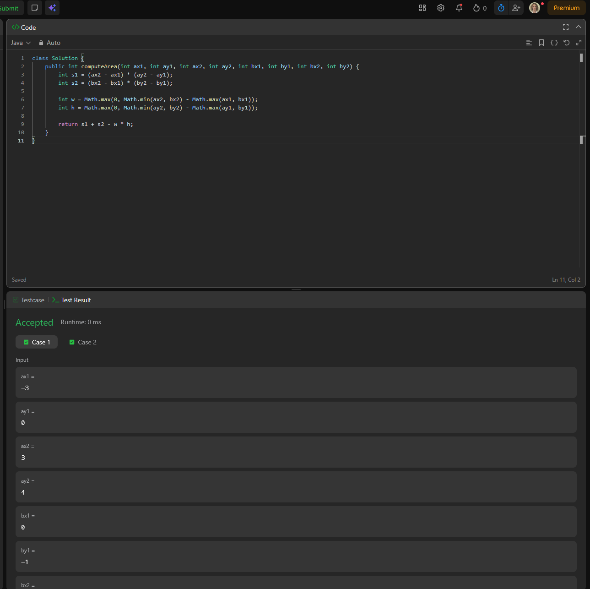
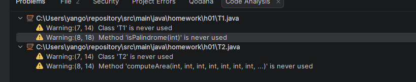

### Java Template Repository

### compile

```shell
mvn compile
```

### clean

```shell
mvn clean
```

### test

```shell
mvn test
```

### reformat code

```shell
mvn spotless:apply
```

### check formatting

```shell
mvn spotless:check
```

# h01{
# t1: 
# t2: 
# problem: 
# }